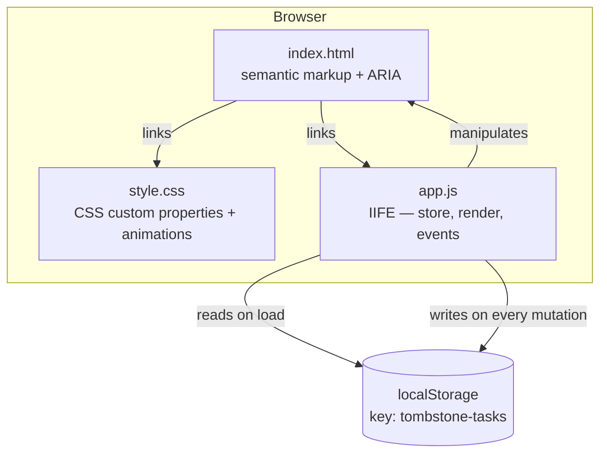

# Design Document: Tombstone Tasks

## Overview

Tombstone Tasks is a static single-page application delivered as three files at the repository root (`index.html`, `style.css`, `app.js`). There is no build step, no framework, no backend, and no network traffic of any kind. All task data is serialized to and read from `localStorage`. The app runs identically from a `file://` URL and from GitHub Pages.

The UI presents every task as a tombstone card inside a graveyard scene. Tasks move through three visual states — alive, buried, and risen (overdue) — driven entirely by DOM mutations against a single in-memory `store` object that is the sole source of truth.

---

## Architecture



**Key architectural decisions:**

- `app.js` is a single IIFE (or top-level script) with no `import`/`export` to preserve `file://` compatibility.
- No `eval()`. All HTML templating uses `document.createElement` + property assignment; `innerHTML` is used only with static, developer-controlled strings, never with unsanitized user input.
- The `store` object is the single source of truth. All reads go through `store`; all writes call `persistStore()` immediately after mutation.
- Rendering is surgical: state changes update only the affected card(s) or the stats bar, not a full re-render of the DOM.

---

## Components and Interfaces

### Add-Task Form

A `<form id="add-task-form">` rendered at the top of the active section (or in a `<dialog>` for smaller viewports).

**Fields:**
- Title: `<input type="text" required>` — validated non-empty before submission.
- Due date: `<input type="date">` — optional.
- Haunting level: a radio fieldset with options `low` (default), `medium`, `high`.
- Submit button: "Plant tombstone" (or equivalent label).

**Behavior:**
- On submit with empty title: prevent default, show inline `<span class="field-error">` beneath the input.
- On valid submit: call `createTask(title, dueDate, hauntingLevel)`, reset the form, re-render the active section and stats bar.

---

### Tombstone Card

A `<article class="tombstone-card">` element. One card per task; always present in either the Active Section or the Graveyard Section, never both.

**State classes applied to the card element:**

| State | CSS class(es) added |
|-------|---------------------|
| Alive | *(none — just `.tombstone-card`)* |
| Buried | `is-buried` |
| Risen (overdue, alive) | `is-risen` |
| Haunting level | `.haunting-low` / `.haunting-medium` / `.haunting-high` |

**Always rendered inside the card:**
- Task title in `<h2>` (textContent = task title).
- Due date in `<p class="card-due-date">` (omitted entirely when no due date is set).
- Haunting-level badge `<span class="haunting-badge haunting-{level}">`.
- Action buttons: Bury (`<button aria-label="Bury: {title}">`), Edit (`<button aria-label="Edit: {title}">`). These appear only on active (alive) cards. Delete (`<button aria-label="Delete: {title}">`) appears only on buried cards.

**Additional content when buried:**
- Epitaph in `<p class="epitaph">` (monospace italic font stack).
- Card rendered at reduced opacity (`opacity: 0.6`) with `transform: translateY(8px)` to look sunken.

**Additional content when risen:**
- `::before` pseudo-element carrying the fog overlay (`background: var(--tt-fog)`; optionally `backdrop-filter: blur(1px)`).
- CSS crack pattern applied via `box-shadow` inset lines.
- Warning icon `<span aria-hidden="true" class="risen-icon">` with sibling `<span class="sr-only">Overdue</span>`.
- The card's `<h2>` renders in `var(--tt-blood-bright)` via `.is-risen h2 { color: var(--tt-blood-bright); }`.
- Float animation on the `::before` overlay (when motion is allowed).

---

### Active Section

`<section id="graveyard-active" aria-label="Active tasks">` — contains tombstone cards for all tasks with `buried === false`. Visible under the All and Alive filters.

---

### Graveyard Section

`<section id="graveyard-buried" aria-label="Graveyard">` — contains tombstone cards for all tasks with `buried === true`. Visible under the All and Buried filters. Rendered below the active section with a visual divider (a "Here lies…" header or similar).

---

### Stats Bar

`<div id="stats-bar" role="status" aria-live="polite">` — fixed/sticky, always visible regardless of scroll.

**Always displays three values:**
1. Buried count: `<span id="stat-buried">`.
2. Survival streak: `<span id="stat-streak">` with the moon glyph (`<span id="moon-glyph" aria-hidden="true">🌕</span><span class="sr-only">Streak moon</span>`) adjacent; moon brightness scales via a CSS custom property `--tt-streak` driven by JavaScript (brightness = `calc(0.5 + var(--tt-streak, 0) * 0.05)`).
3. Alive count: `<span id="stat-alive">`.

Streak label reads "X survival days". When streak is 0, moon glyph is dimmed (`--tt-streak: 0`). Updated by calling `renderStats()` after every state mutation.

---

### Filter Control

`<div id="filter-controls" role="group" aria-label="Filter tasks">` with three `<button>` elements: All, Alive, Buried.

- Active filter button carries `aria-pressed="true"`; the others carry `aria-pressed="false"`. Active button styled via `[aria-pressed="true"]`.
- Clicking a filter sets `store.filter`, then calls `renderAll()`. Filtering is applied during render: `renderTasks()` and `renderGraveyard()` skip non-matching tasks.
- Default on load: All.

---

### Dialogs

All modals use native `<dialog>` elements. Each is opened with `.showModal()` and closed with `.close()`. `autofocus` is placed on the first interactive child.

#### Epitaph Dialog

`<dialog id="epitaph-dialog">` — opened when the user activates the Bury button on a card.

- `<textarea id="epitaph-input" placeholder="Enter an epitaph…" autofocus>` — optional; if empty, an auto-generated epitaph is used.
- Confirm button: triggers `buryTask(taskId, epitaph)`.
- Cancel button: closes dialog, leaves task unchanged.

#### Edit-Task Dialog

`<dialog id="edit-dialog">` — opened with the task's current values pre-populated.

- Title `<input>` (`autofocus`), due-date `<input type="date">`, haunting-level radio fieldset (low/medium/high, matching radio pre-checked).
- Save button: validates non-empty title, calls `updateTask(taskId, fields)`.
- Cancel button: closes dialog, no changes.
- Empty-title submission blocked with inline error, same pattern as the add form.

#### Delete-Confirmation Dialog

`<dialog id="confirm-dialog">` — a brief confirmation prompt.

- Message: "Remove this tombstone forever?"
- Confirm button (`autofocus`): calls `deleteTask(taskId)`.
- Cancel button: closes dialog, no changes.

---

### Page Header

`<header id="page-header">` — contains the app title and bat decorations.

- Bat decorations: up to five `<span aria-hidden="true" class="bat-icon">` elements (SVG or CSS-drawn). JavaScript renders exactly `Math.min(aliveCount, 5)` bat elements after every state change that affects the alive count.
- Moon glyph in the header area (decorative only; `aria-hidden="true"`).

---

## Data Model

### Task Object

```
{
  id:            string,   // generated by generateId(): Date.now().toString(36) + Math.random().toString(36).slice(2)
  title:         string,   // non-empty
  dueDate:       string | null,  // ISO 8601 date "YYYY-MM-DD", null if unset
  hauntingLevel: "low" | "medium" | "high",
  buried:        boolean,  // false = alive, true = buried
  epitaph:       string | null,  // null until buried
  createdAt:     string,   // ISO 8601 datetime (new Date().toISOString())
  buriedAt:      string | null   // ISO 8601 datetime, null until buried
}
```

### Store Object

```
{
  tasks:  Task[],                      // ordered by createdAt descending
  filter: "all" | "alive" | "buried"   // session-only, resets to "all" on every load
}
```

`filter` is session-only state (not persisted); it resets to `"all"` on every load.

### localStorage Serialization

- **Key**: `"tombstone-tasks"`
- **Value**: `JSON.stringify({ tasks: store.tasks })`
- Only `tasks` is persisted; `filter` is not.
- On load: `JSON.parse(localStorage.getItem("tombstone-tasks") ?? "null")`. If the result is `null`, not an object, or its `tasks` field is not an array, the store initializes with `tasks: []`.

```
persistStore():
  localStorage.setItem("tombstone-tasks", JSON.stringify({ tasks: store.tasks }))

loadStore():
  raw = localStorage.getItem("tombstone-tasks")
  IF raw is null THEN
    store.tasks = []
    RETURN
  END IF
  parsed = JSON.parse(raw)   // wrapped in try/catch; on error → store.tasks = []
  IF parsed is not object OR parsed.tasks is not Array THEN
    store.tasks = []
  ELSE
    store.tasks = parsed.tasks
  END IF
```

---

### Survival Streak Computation

The streak counts consecutive calendar days (in the user's local timezone) ending on today, each of which had at least one burial.

```
computeStreak(tasks):
  burialDays = SET of unique date strings "YYYY-MM-DD" extracted from
               task.buriedAt for every task where buried === true

  streak = 0
  day = today (local calendar date as "YYYY-MM-DD")

  WHILE burialDays contains day DO
    streak = streak + 1
    day = day - 1 calendar day
  END WHILE

  RETURN streak
```

A gap of any single day with no burial resets the streak to zero from that point backward. The streak is recomputed live (not stored) whenever `renderStats()` runs.

---

## Rendering Approach

### Initial Load

```
DOMContentLoaded:
  loadStore()
  IF store.tasks is empty (first run) THEN
    seed three sample tasks:
      1. Active task, hauntingLevel "medium", future due date
      2. Buried task with epitaph "They finally replied to that email"
      3. Active task with a past due date (triggers risen styling)
    persistStore()
  END IF
  renderAll()       // calls renderTasks(), renderGraveyard(), renderStats(), renderBats()
  checkRisen()      // marks any already-overdue tasks
  scheduleRisenCheck()  // midnight re-check via setTimeout
```

### renderTasks()

Clears `#graveyard-active`, then for each task in `store.tasks` where `buried === false` (applying `store.filter`), calls `createCardElement(task)` and appends to `#graveyard-active`.

### renderGraveyard()

Clears `#graveyard-buried`, then for each task in `store.tasks` where `buried === true` (applying `store.filter`), calls `createCardElement(task)` and appends to `#graveyard-buried`.

### renderAll()

Calls `renderTasks()`, `renderGraveyard()`, `renderStats()`, and `renderBats()` in sequence.

### Targeted Updates After Mutation

After `createTask()`: call `renderAll()`, or prepend a new card to `#graveyard-active` and update stats/bats.

After `buryTask()`: run bury animation on existing card element, then on animation end call `renderAll()`.

After `updateTask()`: update only the affected card's DOM fields (title, due date, haunting-level class), then `renderStats()` if haunting level changed.

After `deleteTask()`: remove the card element from DOM, `renderStats()`, update bats.

### Bury Animation

```
buryCard(cardEl, onComplete):
  IF prefers-reduced-motion IS active THEN
    onComplete()
    RETURN
  END IF

  Add class "is-burying" to cardEl.
  // CSS: @keyframes bury-sink { to { transform: translateY(20px); opacity: 0; } }
  // CSS: .is-burying { animation: bury-sink 400ms ease forwards; }
  // (gated by @media (prefers-reduced-motion: no-preference))

  ON animationend (or setTimeout fallback at 400ms):
    onComplete()   // moves card to Graveyard Section, applies is-buried class, restores state
```

The `onComplete` callback applies `.is-buried` class, sets opacity/translate for the sunken look via CSS class (not inline style), and appends the card to `#graveyard-buried`.

### Risen (Overdue) Styling

A task is risen when `task.dueDate !== null && task.dueDate < todayString && task.buried === false`.

Risen styling is applied by adding `.is-risen` to the card element. CSS handles all visual effects:

```css
.tombstone-card.is-risen::before {
  content: "";
  position: absolute;
  inset: 0;
  background: var(--tt-fog);
  border-radius: inherit;
  pointer-events: none;
}

@media (prefers-reduced-motion: no-preference) {
  .tombstone-card.is-risen::before {
    animation: fog-float 3s ease-in-out infinite;
  }
}

@keyframes fog-float {
  0%, 100% { transform: translateY(0); }
  50%       { transform: translateY(-3px); }
}
```

Crack pattern via `box-shadow`:
```css
.tombstone-card.is-risen {
  box-shadow:
    inset 2px 4px 0 -1px var(--tt-blood),
    inset -1px 8px 0 -2px var(--tt-blood);
  filter: saturate(0.3);
}
```

Warning text color:
```css
.tombstone-card.is-risen h2 {
  color: var(--tt-blood-bright);
}
```

### Midnight Re-Check

```
scheduleRisenCheck():
  now = new Date()
  msUntilMidnight = (start of next calendar day) - now
  setTimeout(() => {
    renderAll()
    scheduleRisenCheck()   // reschedule for the following midnight
  }, msUntilMidnight)
```

---

## Styling

### Palette Tokens

Declared on `:root` in `style.css`:

| Token | Value | Purpose |
|-------|-------|---------|
| `--tt-bg` | `#0d0d0f` | Page background |
| `--tt-surface` | `#1a1a1f` | Card and panel surfaces |
| `--tt-bone` | `#e8e4d9` | Primary text |
| `--tt-bone-dim` | `#a09a8e` | Secondary / muted text |
| `--tt-green` | `#4a7c59` | Grave green accents, borders, active indicators |
| `--tt-green-glow` | `#6db88a` | Hover states, focus rings |
| `--tt-blood` | `#8b1a1a` | Danger actions, overdue warning backgrounds |
| `--tt-blood-bright` | `#c0392b` | Overdue text and icons |
| `--tt-moon` | `#f5e6a3` | Moon glyph, streak counter highlight |
| `--tt-fog` | `rgba(180,200,180,0.08)` | Fog overlay on overdue tombstones |

### Tombstone Card Shape

The arch is achieved with `border-radius`:

```css
.tombstone-card {
  border-radius: 50% 50% 4px 4px / 30% 30% 4px 4px;
  background: var(--tt-surface);
  border: 1px solid var(--tt-green);
  position: relative;
  padding: 1.5rem 1rem 1rem;
}
```

### Haunting Level Visual Indicators

Haunting level is communicated via a `<span class="haunting-badge haunting-{level}">` badge inside each card. The badge uses a colored left border:

```css
.haunting-badge {
  display: inline-block;
  padding: 0.15em 0.5em;
  border-radius: 3px;
  font-size: 0.75rem;
}

.haunting-low    { border-left: 3px solid var(--tt-green); }
.haunting-medium { border-left: 3px solid #c8a020; }
.haunting-high   { border-left: 3px solid var(--tt-blood-bright); }
```

### Spooky Motif Functions

| Motif | Functional purpose |
|-------|--------------------|
| Bat decorations | Alive task count (capped at 5) — quantity is data |
| Moon glyph | Streak indicator — brightness encodes streak length |
| Fog overlay | Overdue danger signal — redundant with color for accessibility |
| Crack pattern (box-shadow) | Overdue visual texture — adds urgency alongside fog |
| Sunken translate | Buried status — visual depth communicates completion |
| Epitaph monospace italic | Task's final metadata — style distinguishes it from active text |

### Responsive Layout

```css
/* Base: single column, 320px and up */
#task-grid {
  display: grid;
  grid-template-columns: 1fr;
  gap: 1rem;
  padding: 1rem;
}

/* Two columns from 600px */
@media (min-width: 600px) {
  #task-grid { grid-template-columns: repeat(2, 1fr); }
}

/* Three columns from 960px */
@media (min-width: 960px) {
  #task-grid { grid-template-columns: repeat(3, 1fr); }
}

/* Four columns from 1280px */
@media (min-width: 1280px) {
  #task-grid { grid-template-columns: repeat(4, 1fr); }
}
```

No horizontal scrolling at any viewport width from 320 px to 1920 px.

### Focus Ring

Applied globally:

```css
:focus-visible {
  outline: 2px solid var(--tt-green-glow);
  outline-offset: 2px;
}
```

### WCAG AA Contrast

- `--tt-bone` (#e8e4d9) on `--tt-bg` (#0d0d0f): contrast ~14:1 — passes AA.
- `--tt-bone` on `--tt-surface` (#1a1a1f): contrast ~12:1 — passes AA.
- `--tt-blood-bright` (#c0392b) on `--tt-surface` (#1a1a1f): contrast ~4.6:1 — passes AA for normal text. Used only on card surfaces, never on the page background where ratio would differ.
- `--tt-green-glow` (#6db88a) on `--tt-bg`: contrast ~6.2:1 — passes AA.

### Typography

```css
body {
  font-family: -apple-system, BlinkMacSystemFont, "Segoe UI", Roboto,
               Helvetica, Arial, sans-serif;
}

.epitaph {
  font-family: ui-monospace, "Cascadia Code", "Source Code Pro",
               Menlo, Consolas, monospace;
  font-style: italic;
}
```

No external font files referenced anywhere.

---

## Error Handling

### Empty Title Validation

Applies to both the add-task form and the edit dialog.

- On submit: check `title.trim().length > 0`.
- If empty: call `event.preventDefault()`, set `aria-invalid="true"` on the input, show `<span class="field-error" role="alert">Title is required.</span>` immediately below the input.
- On next valid submit: clear `aria-invalid` and remove the error span.

### Corrupt or Missing localStorage

Wrapped in a `try/catch` around `JSON.parse`:

```
loadStore():
  TRY
    raw = localStorage.getItem("tombstone-tasks")
    IF raw is null THEN THROW
    parsed = JSON.parse(raw)
    IF typeof parsed !== "object" OR !Array.isArray(parsed.tasks) THEN THROW
    store.tasks = parsed.tasks
  CATCH
    store.tasks = []
  END TRY
```

The app silently starts with an empty task list. No error is surfaced to the user; data loss from corruption is unrecoverable and no migration strategy is in scope.

### Dialogs Dismissed Without Confirming

- Epitaph dialog cancelled: task remains alive, no epitaph recorded, no burial timestamp set.
- Edit dialog cancelled: task fields unchanged in `store` and in DOM.
- Delete dialog cancelled: task and card remain unchanged.
- All dialogs listen for the native `<dialog>` `cancel` event (Escape key) and the explicit Cancel button click; both paths execute the same no-op guard.

---

## Testing Strategy

The smoke test lives at `smoke-test.mjs` in the repository root. It uses Playwright (Node.js, ES module syntax) to launch a headless browser and load the app via a `file://` URL.

### Test Scenarios and Assertions

**1. App loads without errors** (Requirement 8.2, 9.1)
- Navigate to `index.html` via `file://` URL.
- Assert `document.title` contains "Tombstone Tasks" or a known landmark element (`#graveyard-active`) is present in the DOM.
- Assert no unhandled console errors during load.

**2. Add a task — tombstone appears in Active Section** (Requirement 1.1, 2.1, 2.4)
- Fill the title input with "Test task".
- Select haunting level "medium" radio.
- Submit the form.
- Assert a `.tombstone-card` element exists inside `#graveyard-active` whose text includes "Test task".

**3. Add-task title validation** (Requirement 1.2)
- Submit the form with an empty title.
- Assert the form was not submitted (no new card in DOM).
- Assert a `.field-error` element is visible.

**4. Complete a task — burial and move to Graveyard Section** (Requirement 3.1–3.9)
- With a card in the active section, click its Bury button (`button[aria-label^="Bury:"]`).
- Assert the epitaph `<dialog>` opens.
- Type "They finally replied to that email" in `#epitaph-input`.
- Click the confirm button.
- Assert the card is no longer in `#graveyard-active`.
- Assert the card is present in `#graveyard-buried`.
- Assert the card carries class `is-buried`.
- Assert the card contains a `.epitaph` element with the typed text.

**5. Stats bar updates** (Requirement 4.1–4.6)
- After completing the task above, read `#stat-buried` text content.
- Assert it reflects a buried count of 1.
- Assert `#stat-alive` reflects the remaining alive count.

**6. Filter: Alive** (Requirement 5.3)
- Click the Alive filter button.
- Assert the buried card in `#graveyard-buried` is not visible (has `hidden` attribute or `display: none`).
- Assert any alive cards remain visible.

**7. Filter: Buried** (Requirement 5.4)
- Click the Buried filter button.
- Assert only buried cards are visible.
- Assert alive cards (if any) are not visible.

**8. Filter: All** (Requirement 5.2)
- Click the All filter button.
- Assert all cards (both alive and buried) are visible.

**9. Overdue risen styling** (Requirement 7.1–7.7)
- Add a task with `dueDate` set to a date in the past (e.g. "2000-01-01").
- Assert the resulting card carries class `is-risen`.
- Assert a `.risen-icon` element has `aria-hidden="true"` inside the card.
- Assert a `.sr-only` sibling of the icon contains "Overdue".
- Assert the card's `<h2>` renders in `var(--tt-blood-bright)` (via `.is-risen h2` rule).

**10. localStorage persistence across reload** (Requirement 8.1–8.2)
- After adding a task, reload the page.
- Assert the previously added task's card reappears in `#graveyard-active`.
- Assert buried tasks reappear in `#graveyard-buried`.

### Requirements Coverage Map

| Smoke test scenario | Requirements covered |
|--------------------|---------------------|
| App loads | 8.2, 8.5, 9.1 |
| Add a task | 1.1, 1.3–1.7, 2.1, 2.4 |
| Title validation | 1.2 |
| Complete a task | 3.1–3.9 |
| Stats bar updates | 4.1–4.6 |
| Filter Alive | 5.3 |
| Filter Buried | 5.4 |
| Filter All | 5.2 |
| Risen styling | 7.1–7.7 |
| Persistence across reload | 8.1–8.2 |

---

## Dependencies

None. The application has zero runtime dependencies. Playwright is the sole development dependency and is used only by `smoke-test.mjs`; it is never bundled into or referenced by the application files.
